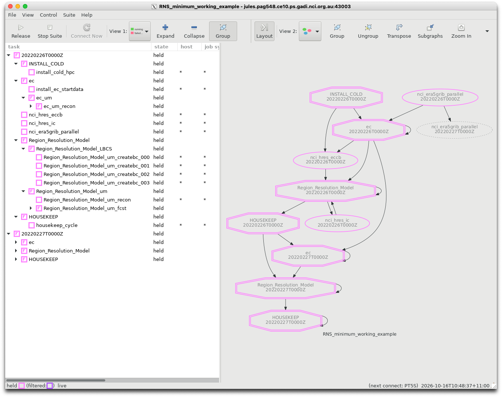
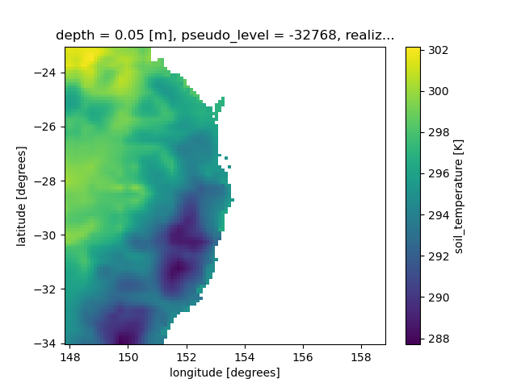

# Running the Regional Nesting Suite

Now we have generated some ancillaries, we can run the UM forecast model!

Let's checkout a 'minimum working example' for the Regional Nesting suite:
```
$ cd ~/roses/
$ git clone git@github.com:21centuryweather/RNS_minimum_working_example.git
```

This is a specially-developed suite designed to run with the Regional Ancillary suite we ran before. All extra logic and features related to operational forecasting, UM source code compilation, atmospheric chemistry, UK-specific features etc. have been removed. 

Because of this
- The suite will not render correctly in the `rose edit` GUI, but
- The `rose-suite.conf` is simple enough that we can examine it directly.

:::{note}

A Jupyter notebook is contained in the suite directory in 
```
~/roses/RNS_minimum_working_example/noteboos/UM_RNS_data_flows.ipynb
```
 which you can use to visualise all data you are generating.

:::

:::{important}

You must be a member of NCI project `ob53` to run this example as it uses the Bureau's BARRA reanalysis data.

:::

## Mapping the ancillary directories to forecast regions

:::{important}
The following is a very important concept within the UM Regional Modelling suites.
:::

Recall for the RAS we defined
- One ancillary region (Lismore-Tiny)
- Two resolutions nested in this region
  - The outer resolution 'era5'
  - An inner resolution 'd1100'

These are labelled in the RAS `rose-suite.conf` as
```
rg01_name="Lismore-tiny"
...
rg01_rs01_name="era5"
...
rg01_rs02_name="d1100"
```
Now if let's examine the RNS `rose-suite.conf`. It contains:
```
dm_nregns=1
dm_name="ec"
..
rg01_name="Lismore-Tiny"
..
rg01_nreslns=1
```
In the RNS (i.e. the forecasting suite) the 'driving model' ancillaries are a separate category from the forecast regions. Remember our 'driving model' is used to provide lateral boundary conditions and initial conditions **ONLY!**. 

So the RNS only starts counting resolutions and regions for domains where the UM forecast model is run.

The table below summarises this mapping between the RAS ancillaries and the RNS domain definitions. This mapping applies for a single region.

| Ancillary Suite | Nesting suite | Domain type    | 
|-----------------|---------------|----------------|
| rg01_rs01       | dm            | Driving model  |  
| rg01_rs02       | rg01_rs01     | Forecast model nest 1 |
| rg01_rs03       | rg01_rs02    | Forecast model nest 2 |
| rg01_rs04       | rg01_rs03    | Forecast model nest 3|
| ... | ... | ... |
| rg01_rs0[N] | rg01_rs0[N-1] | Forecast model nest N-1 |

For our minimum working example we are only running with N=2 ancillary domains, so we are only running a single forecast domain(N=1)

:::{important}

Keeping track of which ancillary files define your first Forecast model nest will be very important when considering your choice of land-surface dataset set. This will be touched on later.

:::

In the RNS `rose-suite.conf` file, the following definitions are used to define the location of the ancillary files for the driving model and first forecast model nest:
```
dm_ec_lam_ancil_dir="/scratch/$PROJECT/$USER/cylc-run/RAS_minimum_working_example/share/data/ancils/Lismore-tiny/era5"
rg01_rs01_ancil_dir="/scratch/$PROJECT/$USER/cylc-run/RAS_minimum_working_example/share/data/ancils/Lismore-tiny/d1100"
```
These directories should have been created and populated with ancillary data when you ran the RAS suite. 

**Make sure they still have data in them!**

:::{note}
- The RNS and RAS assume you are running on your default `gadi` project which is specified in the file `~/.config/gadi-login.conf`. If the value of `PROJECT` in this file has changed, you might have to manually alter the definition of the above ancillary directory files.
- NCI routinely clean the contents of your `/scratch/$USER` directory every 100 days. So your ancillaries may get deleted if you haven't touched that directory recently.
:::

## Running the suite - task by task

Let's step through each task of the suite step-by-step and discuss the associated `rose/cylc` logic of each task. When we load the suite and hold with the command
```
$ rose suite-run -- --hold
```
you will see the following.



Let's compare the graphical task flow on the right of that image to the task flow specified in the `suite.rc` file.
```
             graph = """
            install_cold_hpc
            install_cold_hpc[^] => install_ec_startdata
            install_cold_hpc => nci_hres_eccb                      
            nci_era5grib_parallel => ec_um_recon_000
```
So the first tasks to start (i.e. those that have no prior dependencies) are `install_cold_hpc` and `nci_era5grib_parallel`.  

### install_cold_hpc

From the `suite.rc` we can see `install_cold_hpc` installs various links to existing data at NCI. How does it do this? When you trigger this task, you'll see the job script contains the logic
```
cylc__job__inst__script() {
# SCRIPT:
rose task-run -v --opt-conf-key='(nci-gadi)'
}
```
Recall from the `rose` tutorials that the use of optional configuration keys automatically points to application files located in `app/<task>/opt/rose-app-<key>.conf`. If you look at the contents of `app/install_cold_hpc/opt/rose-app-nci-gadi.conf` you'll see a long list of UM configuration files on `gadi` that are now linked to your `cylc-run` directory. For example, the file `app/install_cold_hpc/opt/rose-app-nci-gadi.conf` contains:
```
[file:$ROSE_DATA/etc/um_spectral_ga6]
mode=symlink
source=${UMDIR}/vn${UM_VN}/ctldata/spectral/ga3_0

[file:$ROSE_DATA/etc/um_spectral_ga7]
mode=symlink
source=${UMDIR}/vn${UM_VN}/ctldata/spectral/ga7
```
If you look in `~/cylc-run/share/data/etc/` you'll see the corresponding links now exist.
```
lrwxrwxrwx 1 pag548 ce10   66 Oct 16 10:54 um_spectral_ga6 -> /g/data/access/projects/access/umdir/vn13.5/ctldata/spectral/ga3_0
lrwxrwxrwx 1 pag548 ce10   64 Oct 16 10:54 um_spectral_ga7 -> /g/data/access/projects/access/umdir/vn13.5/ctldata/spectral/ga7
```

### nci_era5_grib_parallel

This task sets up the initial conditions for your run. It will retrieve grids of the ERA5 global analysis which is created by the European Centre for Medium Range Weather Forecasting (ECMWF), valid at the dates you specify. The task login in `suite.rc`
```
    [[nci_era5grib_parallel]]
        inherit=None, HOST_HPC
        pre-script = mkdir -p $OUTDIR
        [[[ environment ]]]
            OUTDIR={{dm_ec_ic_lbc_dir}}
``` 
tells us it will store them in directory specified as `dm_ec_ic_lbc_dir` in our `rose-suite.conf` file. Here, `dm_ec_ic_lbc_dir` is shorthand for **d**riving **m**odel **E**uropean **Centre** **i**nitial **c**onditions **l**ateral **b**ounday **c**conditions **dir**ectory. The default setting from `rose-suite.conf` is
```
dm_ec_ic_lbc_dir="/scratch/$PROJECT/$USER/EC_GRIB_PARALLEL"
```
If you examine this directory you'll find the following files:
```
ec_grib_202202260000.t+000  
ec_grib_202202260100.t+000  
ec_grib_202202260200.t+000  
ec_grib_202202260300.t+000  
ec_grib_202202260400.t+000  
ec_grib_202202260500.t+000  
ec_grib_202202260600.t+000
```
If you use the suite's notebook mentioned above, you'll notice each file contains 19 variables. The grib files have gobal extent defined on a 0.25 degree grid.

### ec_um_recon

The next set of tasks fall within the `ec` task family. First we run `install_ec_startdata` which is creates a directory to store regional model's initial conditions. From `suite.rc`
```
{# Driving model task family #}
[[ec]]
    [[install_ec_startdata]]
        inherit = ec, ARCHIVE
        pre-script = mkdir -p $ROSE_DATAC/ec/ics/
```
Next we run `ec_um_recon`, which spawns one reconfiguration task for every hour for the first day of our simulation.
The reconfiguration task uses an Fortran executable that is build from the UM source code. The reconfigure task itself is a UM task and we can follow the logic chain in `suite.rc`
```
[[ec_um]]
    # Settings for all DM recon and forecast tasks.

... (skip) ...

    [[[environment]]]
        DRV_MOD=ec
        CRUN_LEN = {{CRUN_LEN}}
        ROSE_APP_OPT_CONF_KEYS = $DUST_OPT $EC_OPT
        ROSE_TASK_APP = glm_um
```
Note the use of a `jinja` loop to define 24 seperate `ec_um_XXX` tasks. First, the `jinja` logic is defined near the top of the `suite.rc` file (lines 38-40)
```
{# For EC driving model set up n_lbcs so that can set up correct number of driving model 
   recon jobs. Our EC data is stored in hourly files. We add '+1' so the jinja loop will run from 00 to 24 #}

```
Which allows to specify 24 seperate  `ec_um_XXX` that will each produce an initial condition valid for a specific hour.
```
[[ec_um_recon]]
inherit = ec_um

    
    
    
        [[ec_um_recon_{{lbc}}]]
            # Settings for any DM reconfiguration task.
            inherit = ec_um_recon

            ...(skip)...

            script = {{TASK_RUN_COMMAND}} --path="share/spack_build/*/bin" --command-key=recon

            ...(skip)...
 
```
The contents of `app/glm_um/rose-app.conf` show
```
meta=um-atmos/vn13.5

[command]
default=um-atmos
recon=um-recon
```
So we using the UM to not actually run an atmospheric forecast, but to
1) Regrid the original ERA5 data onto our regional domain, and
2) Integrate all the ancillary information we defined previously in the Regional Ancillary Suite into our domain.

The initial conditions are now availabe in your directory `~/cylc-run/RNS_minimum_working_example/share/cycle/20220226T0000Z/ec/um/`
```
$ ls ~/cylc-run/RNS_minimum_working_example/share/cycle/20220226T0000Z/ec/um/
ec_cb000  
ec_cb001  
ec_cb002
ec_cb003
...
```  
If you run the notebook now, it will cp `ec_cb000` to `ec_cb000_init` so this original file is stored.  That's because subsequent tasks will over-write `ec_cb000` with improved land-surface data.

Note these files contain **116 variables**!  A large increase from the 19 from the original ERA5 data. The data now includes all the additional atmospheric and land-surface data from our ancillaries. Here is a plot of the initial soil temperature taken from the ERA5 data and re-gridded to our regional test domain.



### nci_hres_eccb

The next task in our suite will provide higher-resolution land/surface data. Note the task flow definitions from `suite.rc`
```
ec_um_recon_000  =>  nci_hres_eccb => Region_Resolution_Model_um_recon => nci_hres_ic => 
```
The value of `NCI_HRES_ECCB` in `rose-suite.conf` will determine the choice of land/surface data. In this example,
```
NCI_HRES_ECCB="barra"
```
Which means we will be using the Bureau's BARRA Australian re-analysis to provide land/surface data at 0.11 degree increments. If you wish to use BARRA you must have membership of the NCI project `ob53`.

:::{note}

The other options available for NCI_HRES_ECCB are 'none' (use original ERA5 data) or 'era5land' which takes land/surface data from the ERA5-**Land** reanalysis defined at 0.1 degrees resolution. 

:::

:::{important}

The type of land/surface dataset determines the outer resolution of your regional model. Here is a summary of the restrictions on the Ancillary suite `rg01_rs01` definition, which correponds to `dm` in the Nesting suite.  

| Data Source| NCI_HRES_ECCB | Required resolution | 
| ---------- | --------- | --------- | 
| default (ERA5)   | none          | No restriction. |
| ERA5-land | era5land | 0.1 degrees |
| BARRA | barra | 0.11 degrees |

For ERA5-land, the grid point locations of your outer domain defined as `rg01_rs01` **MUST** be defined at 0.1 degree intervals, e.g. 39.4, 39.5, 39.5 etc.

For of BARRA, the grid point locations of your outer domain defined as `rg01_rs01` **MUST MATCH EXCATLY** the grid point locations of the BARRA grid. Hence, you are best examining BARRA data first to find out exactly what these points are. In our example, sample longitude points are 152.06, 152.17, 152.28 etc.

See [here](https://docs.access-hive.org.au/models/run_a_model/run_access-ram3/#change-the-nested-regions-nest-configuration) for further confirmation.

:::

After running the `nci_hres_eccb` task for our example, the file `ec_cb000` is updated with higher resolution land/surface data.  Only the first hour reconfiguration file is changed, as this forms the initial condition for our first day of simulation. The remaining reconfiguration files (hours 01-24) are used to defined the lateral boundary conditions.

If you are following along with the notebook, it will copy `ec_cb000` to `ec_cb000_hres` so this original file is stored. This allows us to see the impact of using a higher resolution land/surface data on the soil temperature of our initial condition. This figure is replicated below.

[BARRA soil temp](./images/BARRA_soil_temp.png)

### Region_Resolution_Model_um_recon

All our processing now has involved setting up the initial conditions on the 100x100 'Driving Model' grid. Now we need to run the reconfiguration task to create the initial conditions on the first (and in our case, only) 50x50 forecast model nest. The task `Region_Resolution_Model_um_recon` will regrid the ERA5 data onto our nest mesh, and apply all the ancillary data. The output is a file called `GAL9_astart`, where `GAL9` refers to **G**lobal **A**tmosphere Version 9, i.e. the atmospheric science package used by the UM for lower-resolution, global runs.

Note the task logic from the `suite.rc` file
```
 ec_um_recon_000  =>  nci_hres_eccb => Region_Resolution_Model_um_recon
```

If you are following along with the notebook, it will copy `GAL9_astart` to `GAL9_astart_init` so this original file is stored. This file contais 167 variables!

### nci_hres_ic

This task replicates `nci_hres_eccb` but applies it to our forecast grid, i.e. it will update the land/surface data of forecast net initial condition file with better resolution data.

Note the task logic from the `suite.rc` file
```
 ec_um_recon_000  =>  nci_hres_eccb => Region_Resolution_Model_um_recon => nci_hres_ic
```

If you are following along with the notebook, it will copy the updated `GAL9_astart` to `GAL9_astart_hres` so we can compare the differences in the two ASTART files. The figure below is taken from the notebook.

[ASTARTsoil temp](./images/ASTART_soil.png)

### Region_Resolution_Model_LBCS

Now we move to generate the **L**ateral **B**oundary **C**onditions for our forecast nest. These define the temporal evolution of the flow gradients along the nest boundaries. Because of the temporal nature of the LBCs, we need multiple tasks to span the 24 hour period. So within the `Region_Resolution_Model_LBCS` task family, we will have multiple `Region_Resolution_Model_um_createbc_XXX` tasks. Again, this is done inside `suite.rc` using `jinja` templates.

First we have a `jinja` macro at lines 35-36 of `suite.rc` which takes the variables `CYLC_INT_HR` and `CRUN_LEN` from `rose-suite.conf` to determine how many tasks we need.

The values set in `rose-suite.conf` are
```
CRUN_LEN=6
CYCLE_INT_HR=24
```
Which means we are going to run a 6 hourly forecast run and begin a new forecast cycle every 24 hours. Hence, we need four seperate forecast tasks for each daily cycle. Therefore, we need four LBC tasks. The `jinja` macro computes `n_cruns` using
```
{# Set the number of UM tasks/day #}

```
Andn then we have a loop which creates multiple `um_createbc` and `um_fcst` tasks.
```
      
          
          nci_hres_eccb => Region_Resolution_Model_um_createbc_{{crp}} => Region_Resolution_Model_um_fcst_{{crp}}
        
```
